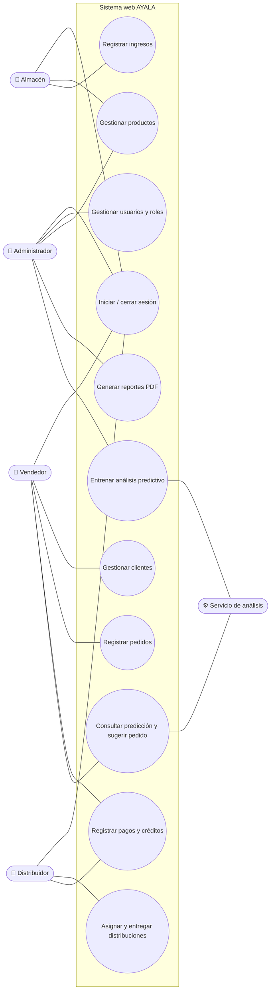
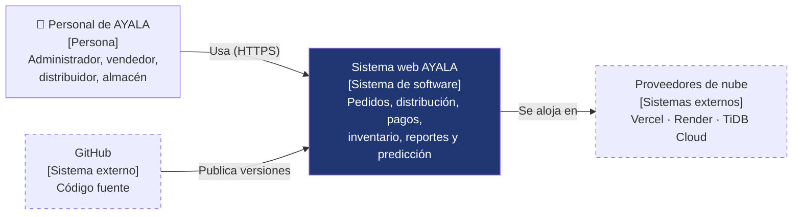
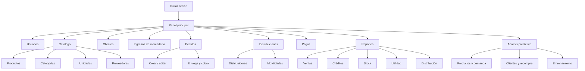
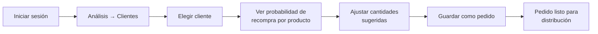
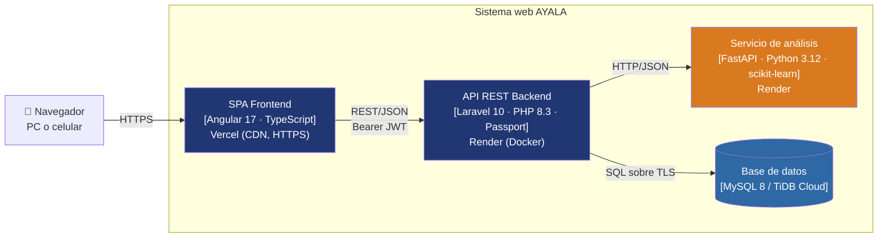
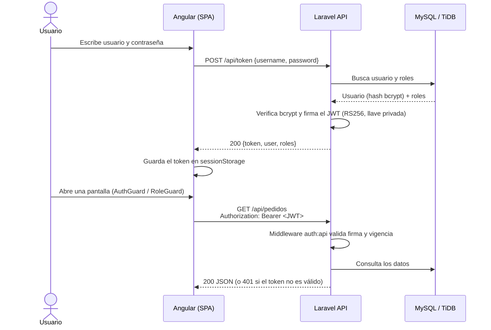
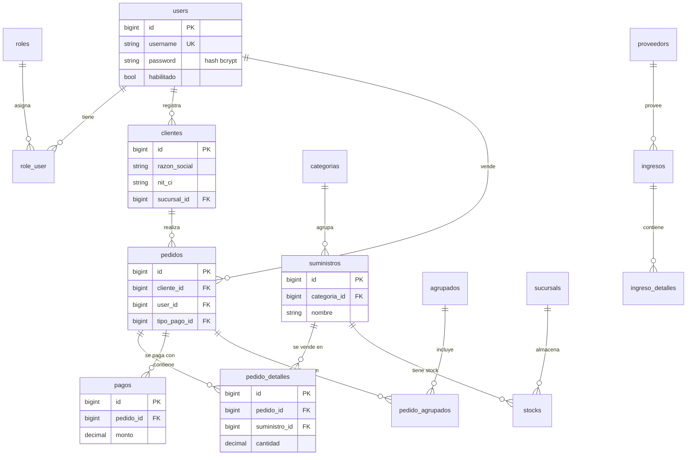
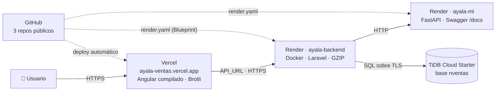

# Sistema web de gestión comercial con análisis predictivo — Distribuidora AYALA

**Documentación técnica final del Proyecto Integrador**

| | |
|---|---|
| **Universidad** | Universidad Adventista de Bolivia — Facultad de Ingeniería |
| **Carrera** | Ingeniería de Sistemas |
| **Asignatura** | Tecnologías en Internet (TEC-644) |
| **Docente** | Ing. Victor Hugo Sarzuri Flores |
| **Estudiante** | Brian Rehi Tarqui Vasquez |
| **Gestión** | 2-2026 · Cochabamba, 25 de noviembre de 2026 |
| **Repositorio GitHub (público)** | **https://github.com/tarqui9/ayala-ventas** |
| **Aplicación en la nube** | **https://ayala-ventas.vercel.app** |
| **API REST (backend)** | https://ayala-backend-wmhh.onrender.com/api |
| **Servicio de análisis (Swagger)** | https://ayala-ml.onrender.com/docs |

---

## Índice

1. Resumen ejecutivo y alcance
2. Trazabilidad de requisitos
3. Diseño UX/UI
4. Arquitectura fullstack
5. Persistencia de datos
6. API REST
7. Seguridad
8. Despliegue en la nube y demostración
9. Optimización, estándares web y auditoría ética
10. Manual de ejecución y pruebas
11. Conclusiones, trabajo futuro y valores
12. Anexo: correspondencia con los criterios de evaluación

---

## 1. Resumen ejecutivo y alcance

El sistema reemplaza los procesos manuales de la Distribuidora AYALA, una empresa de productos de limpieza de Cochabamba, por una **aplicación web fullstack desplegada en la nube**. El personal registra pedidos, distribuciones, pagos e ingresos de mercadería desde el navegador. La gerencia obtiene reportes en PDF al instante y, además, una **predicción de qué productos y cuándo volverá a comprar cada cliente**, que el sistema convierte en una sugerencia de pedido.

**Alcance logrado en esta entrega:**

- Frontend SPA en **Angular 17**, publicado en **Vercel**.
- API REST en **Laravel 10**, con autenticación **JWT (Laravel Passport, OAuth2)**, en un contenedor **Docker** publicado en **Render**.
- Microservicio de análisis predictivo en **Python 3.12 + FastAPI + scikit-learn**, publicado en **Render**, con documentación **Swagger (OpenAPI)**.
- Base de datos **MySQL 8** en local y **TiDB Cloud** (compatible con MySQL) en la nube, con conexión cifrada.
- Entorno local completo con **Docker Compose**: 5 contenedores.
- Código en **3 repositorios públicos** de GitHub.

**Tecnologías integradas**

| Capa | Tecnología | Equivalente visto en la materia |
|---|---|---|
| Frontend | Angular 17, TypeScript, HTML5, SCSS, Angular Material, Bootstrap 5 | HTML5, CSS3, JavaScript, React |
| Comunicación | HttpClient (AJAX), JSON, REST | Fetch API, AJAX |
| Backend | Laravel 10 (PHP 8.3), Eloquent ORM | Node.js + Express, TypeORM/Mongoose |
| Autenticación | Laravel Passport (OAuth2, JWT RS256), bcrypt | JWT, OAuth2, bcryptjs |
| Servicio de análisis | FastAPI, scikit-learn (Random Forest), pandas | API REST + Swagger |
| Base de datos | MySQL 8 / TiDB Cloud | MongoDB / MongoDB Atlas |
| Contenedores | Docker, Docker Compose | Docker, Docker Compose |
| Nube | Vercel, Render, TiDB Cloud, GitHub | Vercel, Render, MongoDB Atlas |

---

## 2. Trazabilidad de requisitos

### 2.1 Requisitos funcionales (RF)

Cada requisito sigue la forma *"El sistema debe [acción] + [entidad] + [condición]"*.

| Código | Módulo | Requisito | Prioridad |
|---|---|---|---|
| RF-01 | Autenticación | El sistema debe autenticar a los usuarios mediante nombre de usuario y contraseña, y entregar un token JWT válido por sesión. | Alta |
| RF-02 | Usuarios | El sistema debe permitir al administrador registrar, editar, habilitar o deshabilitar usuarios y asignarles un rol. | Alta |
| RF-03 | Clientes | El sistema debe permitir registrar, editar y consultar clientes con su razón social, NIT/CI y sucursal. | Alta |
| RF-04 | Productos | El sistema debe permitir gestionar productos, categorías y unidades de medida, y habilitar o deshabilitar cada uno. | Alta |
| RF-05 | Inventario | El sistema debe registrar los ingresos de mercadería por proveedor y actualizar el stock disponible de cada sucursal. | Alta |
| RF-06 | Pedidos | El sistema debe permitir al vendedor crear, editar y anular pedidos de un cliente, validando el stock disponible. | Alta |
| RF-07 | Distribución | El sistema debe agrupar pedidos en una distribución, asignarla a un distribuidor y registrar su despacho, entrega o devolución. | Alta |
| RF-08 | Pagos | El sistema debe registrar los pagos de cada pedido y mostrar el saldo pendiente de los clientes con crédito. | Alta |
| RF-09 | Reportes | El sistema debe generar reportes de ventas, créditos, stock, utilidad y distribución por rango de fechas, en pantalla y en PDF. | Media |
| RF-10 | Análisis predictivo | El sistema debe entrenar un modelo predictivo con el historial de ventas cuando el administrador lo solicite. | Media |
| RF-11 | Análisis predictivo | El sistema debe mostrar, para cada cliente, la probabilidad de recompra de cada producto y la fecha estimada de su próxima compra. | Media |
| RF-12 | Análisis predictivo | El sistema debe generar una sugerencia de pedido a partir de la predicción y permitir guardarla como un pedido real. | Media |

### 2.2 Requisitos no funcionales (RNF)

| Código | Tipo | Requisito | Cómo se cumple / medición |
|---|---|---|---|
| RNF-01 | Seguridad | Solo los usuarios autenticados acceden a los datos; las contraseñas nunca se guardan en texto plano. | JWT firmado con RS256 (Passport) y contraseñas con hash **bcrypt**. Verificado en la nube: sin token, la API responde **401**. |
| RNF-02 | Seguridad | Todo el tráfico viaja cifrado. | **HTTPS** en Vercel y Render; conexión a TiDB Cloud con **TLS** (`MYSQL_ATTR_SSL_CA`). |
| RNF-03 | Rendimiento | La página principal carga en menos de 2 s y los recursos se envían comprimidos. | Medido: **0,41 s** hasta el primer byte del frontend; JavaScript principal de **1,19 MB → 0,30 MB con Brotli** (−75 %). La API responde con **GZIP**. |
| RNF-04 | Compatibilidad / responsive | La interfaz funciona en navegadores modernos y en celulares. | Bootstrap 5 (Grid/Flexbox) y Angular Material; formularios específicos para móvil (`form-crear-pedidos-movil`, `crear-ingresos-movil`). |
| RNF-05 | Integridad | Una venta o un ingreso no puede quedar guardado a medias. | Transacciones de base de datos (`DB::beginTransaction` / `DB::transaction`) en ingresos, distribuciones y pedidos sugeridos. |
| RNF-06 | Portabilidad | El sistema se instala igual en cualquier equipo o servidor. | Un `Dockerfile` por servicio y `docker-compose.yml`; la misma imagen del backend corre en local y en Render. |
| RNF-07 | Disponibilidad | Si el servicio de análisis falla, las ventas siguen funcionando. | El análisis es un servicio independiente; pedidos, pagos e inventario no dependen de él. |
| RNF-08 | Mantenibilidad | El código está separado por capas y módulos. | Frontend, backend y análisis en proyectos separados; Laravel con controladores, modelos y servicios; Angular con 13 módulos de carga diferida. |

### 2.3 Casos de uso



#### Caso de uso 1: Iniciar sesión

| | |
|---|---|
| **Actores** | Cualquier usuario del sistema |
| **Precondición** | El usuario existe y está habilitado. |
| **Flujo principal** | 1. El usuario escribe su nombre de usuario y contraseña. 2. Angular envía `POST /api/token`. 3. Laravel verifica la contraseña con bcrypt. 4. Passport genera un JWT firmado. 5. Angular guarda el token y redirige según el rol (administrador → panel, vendedor → pedidos, distribuidor → distribuciones, almacén → ingresos). |
| **Flujos alternativos** | 3a. Credenciales incorrectas: la API responde **409** "Usuario no registrado" y Angular muestra el aviso. 3b. Usuario deshabilitado: la API responde **409** "Usuario no habilitado". |
| **Postcondición** | El usuario tiene una sesión activa y cada petición lleva `Authorization: Bearer <token>`. |

#### Caso de uso 2: Registrar un pedido

| | |
|---|---|
| **Actores** | Vendedor |
| **Precondición** | Sesión iniciada; el cliente y los productos existen. |
| **Flujo principal** | 1. El vendedor abre *Pedidos → Crear*. 2. Elige el cliente y el tipo de pago. 3. Agrega productos y cantidades. 4. Angular envía `POST /api/pedidos`. 5. Laravel valida los datos y el stock y guarda el pedido con su detalle. 6. Se muestra el pedido en la lista y se puede imprimir en PDF (`GET /api/pedidos/pdf/{id}`). |
| **Flujos alternativos** | 5a. Stock insuficiente o datos inválidos: la API responde con error y no guarda nada, gracias a la transacción. |
| **Postcondición** | El pedido queda registrado y listo para asignarse a una distribución. |

#### Caso de uso 3: Consultar la predicción y sugerir un pedido

| | |
|---|---|
| **Actores** | Vendedor o administrador; servicio de análisis |
| **Precondición** | El análisis fue entrenado al menos una vez (`POST /api/analisis/entrenar`). |
| **Flujo principal** | 1. El usuario abre *Análisis → Clientes* y elige un cliente. 2. Angular pide `GET /api/analisis/clientes/{id}`. 3. Laravel combina el historial del cliente con el informe del modelo. 4. Se muestran la probabilidad de recompra por producto y la fecha estimada. 5. El usuario ajusta cantidades y guarda la sugerencia como pedido (`POST /api/analisis/clientes/{id}/pedidos`). |
| **Flujos alternativos** | 3a. El servicio de análisis no responde: se muestra solo el historial, sin porcentajes. 5a. Producto duplicado o cantidad inválida: la API rechaza la sugerencia sin guardar nada. |
| **Postcondición** | Se crea un pedido real a partir de la predicción. |

### 2.4 Diagrama C4 — Nivel 1 (Contexto)



### 2.5 Matriz de trazabilidad (RF → frontend → backend)

| RF | Componente Angular | Endpoint / servicio backend |
|---|---|---|
| RF-01 | `signin`, `AuthGuard`, `RoleGuard`, `JwtInterceptor` | `POST /api/token`, `GET /api/logout`, `POST /api/users/change-password` |
| RF-02 | `lista-usuarios`, `crear-usuarios` | `GET/POST /api/users`, `PUT/DELETE /api/users/{id}`, `GET /api/users/habilitar/{id}`, `GET /api/users/roles` |
| RF-03 | `lista-clientes`, `crear-clientes` | `GET/POST /api/clientes`, `GET/PUT/DELETE /api/clientes/{id}` |
| RF-04 | `lista-suministros`, `crear-suministros`, categorías, unidades | `/api/suministros`, `/api/categorias`, `/api/unidades` (CRUD + `habilitar/{id}`) |
| RF-05 | `listar-ingresos`, `crear-ingresos`, `crear-ingresos-movil` | `GET/POST /api/ingresos`, `GET /api/ingresos/pdf/{id}` |
| RF-06 | `tabla-pedidos`, `form-crear-pedidos`, `form-crear-pedidos-movil` | `GET/POST /api/pedidos`, `PUT/DELETE /api/pedidos/{id}`, `GET /api/pedidos/pdf/{id}` |
| RF-07 | `tabla-lista-distribuciones`, `form-crear-distribuciones` | `GET/POST /api/agrupados`, `GET /api/agrupados/despachar/{id}`, `/entrega/{id}`, `/devolver/{id}` |
| RF-08 | `lista-pagos`, `tabla-pagos`, `form-cobro-pedido` | `GET/POST /api/pagos`, `GET /api/reportes/creditos` |
| RF-09 | `reporte-ventas`, `reporte-creditos`, `reporte-stock-productos`, `reporte-util`, `reporte-distribuciones`, `reporte-venta-productos` | `GET /api/reportes/{ventas,creditos,stock,utilidad,distribucion,ventaproductos}` y sus versiones `-pdf` |
| RF-10 | `analisis` (pantalla *Entrenamiento*) | `POST /api/analisis/entrenar` → `POST /train` (FastAPI) |
| RF-11 | `analisis` (pantallas *Clientes* y *Productos*) | `GET /api/analisis/reporte`, `GET /api/analisis/clientes/{id}` → `GET /report` (FastAPI) |
| RF-12 | `sugerencias-pedido` | `POST /api/analisis/clientes/{id}/pedidos`, `PUT /api/analisis/clientes/{id}/pedidos/{pedido}` |

---

## 3. Diseño UX/UI

### 3.1 Usuarios objetivo (personas)

| | **Gerente / administrador** | **Vendedor de campo** |
|---|---|---|
| **Perfil** | Dueño o encargado de la distribuidora; usa una computadora en oficina. | Recorre tiendas y almacenes; usa sobre todo el celular. |
| **Objetivos** | Ver ventas, deudas y stock al instante; decidir qué comprar. | Registrar pedidos rápido y saber qué ofrecer a cada cliente. |
| **Frustraciones actuales** | Reportes que tardan días; errores en el inventario. | Facturas manuales lentas; olvida qué compra cada cliente. |
| **Qué le da el sistema** | Panel, reportes PDF y análisis de demanda. | Formularios móviles y sugerencia de pedido por cliente. |

### 3.2 Mapa del sitio



### 3.3 Flujo de usuario clave: del análisis al pedido



### 3.4 Sistema de diseño

Los valores salen del tema real de la aplicación (`src/assets/scss/_moderno.scss`).

| Elemento | Definición |
|---|---|
| **Color primario** | `#4F46E5` (índigo), hover `#4338CA`, fondo suave `#EEF2FF` |
| **Texto** | principal `#1E293B`, secundario `#64748B` |
| **Superficies** | fondo `#F5F7FB`, tarjetas `#FFFFFF`, bordes `#E2E8F0` |
| **Estados** | éxito, error, advertencia e información con alertas de SweetAlert2 y colores semánticos de Bootstrap |
| **Tipografía** | Inter (alternativas: Segoe UI, Roboto, sans-serif) |
| **Forma** | tarjetas con radio de 14 px y sombra suave; botones y campos con radio de 10 px |
| **Componentes** | botones, campos *outlined*, tablas con resaltado al pasar el mouse, tarjetas, modales y barra lateral de Angular Material y Bootstrap |

### 3.5 Prototipo y diseño responsive

- **Prototipo en Figma:** *[agregar aquí el enlace de Figma]*
- **Interfaz implementada:** https://ayala-ventas.vercel.app. Es responsive con el grid de Bootstrap 5 y tiene formularios específicos para celular en pedidos e ingresos.

---

## 4. Arquitectura fullstack

### 4.1 Diagrama C4 — Nivel 2 (Contenedores)



**Decisiones de arquitectura**

- **Cliente-servidor desacoplado:** Angular nunca toca la base de datos; todo pasa por la API REST. Por eso el frontend se puede publicar como archivos estáticos en una CDN (Vercel).
- **Microservicio para el análisis:** el modelo predictivo usa Python, el ecosistema natural para *machine learning*, y vive en un servicio separado. Laravel lo llama por HTTP con la variable `PREDICTIVO_URL`.
- **Configuración por variables de entorno:** la misma imagen Docker del backend funciona en local y en la nube cambiando solo variables.

### 4.2 Diagrama de secuencia: autenticación y autorización con JWT



**Dónde está en el código**

| Paso | Archivo |
|---|---|
| Login y emisión del token | `laravel_nventas-main/app/Http/Controllers/Api/AuthController.php` |
| Rutas protegidas | `laravel_nventas-main/routes/api.php` (grupo `auth:api`) |
| Guard `api` con Passport | `laravel_nventas-main/config/auth.php` |
| Guardar el token | `app ang ventas/src/app/core/authentication/token-storage.service.ts` |
| Enviar el token en cada petición | `app ang ventas/src/app/core/interceptor/jwt.interceptor.ts` |
| Proteger pantallas | `app ang ventas/src/app/core/guard/auth.guard.ts` y `role.guard.ts` |

### 4.3 Organización de los repositorios

| Repositorio | Contenido |
|---|---|
| [`ayala-ventas`](https://github.com/tarqui9/ayala-ventas) (principal) | `ml/` (servicio Python), `docker-compose.yml`, `render.yaml`, `README.md`, `.env.example` |
| [`laravel-nventas-backend`](https://github.com/tarqui9/laravel-nventas-backend) | API Laravel: `app/` (controladores, modelos, servicios), `routes/`, `database/migrations`, `tests/`, `Dockerfile` |
| [`angular-ventas-frontend`](https://github.com/tarqui9/angular-ventas-frontend) | SPA Angular: `src/app/` (módulos, componentes, servicios, guards, interceptores), `vercel.json` |

Los secretos (`.env`, llaves RSA y volcados de la base) están excluidos con `.gitignore` y `.dockerignore`.

---

## 5. Persistencia de datos

### 5.1 Modelo de datos (tablas principales)

La base `nventas` tiene **35 tablas**. Este diagrama resume las principales:



### 5.2 Por qué una base relacional y no MongoDB

En la materia se estudió MongoDB (NoSQL documental). Para este sistema se eligió **MySQL, una base relacional**, por tres razones:

1. **Transacciones:** al registrar una venta hay que guardar el pedido, su detalle y la salida de stock al mismo tiempo. Si falla un paso, no debe quedar nada guardado. Las transacciones ACID de MySQL lo garantizan.
2. **Datos con estructura fija y muy relacionados:** clientes, pedidos, pagos y productos se cruzan constantemente en los reportes. Las llaves foráneas (36 relaciones) mantienen la integridad.
3. **Reportes con JOIN y agregaciones:** ventas por vendedor, créditos pendientes y utilidad por producto se resuelven con consultas SQL.

MongoDB sería una buena opción para datos sin esquema fijo, por ejemplo para guardar los resultados del modelo predictivo como documentos JSON. Queda como trabajo futuro.

| Concepto de la materia (MongoDB) | Equivalente en el proyecto |
|---|---|
| Colección | Tabla |
| Documento | Fila (registro) |
| Mongoose (ODM): modelos, validación | **Eloquent (ORM)**: modelos de Laravel y validación con `Validator` |
| Esquema Mongoose | **Migraciones** de Laravel (`database/migrations`) |
| Índices | Índices de llaves primarias, foráneas y campos únicos (`username`, `email`) |
| MongoDB Atlas (nube) | **TiDB Cloud Starter** (compatible con MySQL, gratis) |

---

## 6. API REST

### 6.1 Convenciones

- **Base URL:** `https://ayala-backend-wmhh.onrender.com/api`
- **Formato:** JSON en peticiones y respuestas. Los PDF se devuelven como archivo.
- **Autenticación:** `Authorization: Bearer <token JWT>` en todas las rutas del grupo `auth:api`.
- **Total:** **117 rutas**, organizadas como recursos REST (`index`, `store`, `show`, `update`, `destroy`).

**Códigos de estado usados**

| Código | Significado en el sistema |
|---|---|
| 200 | Operación correcta |
| 201 | Recurso creado |
| 400 | Faltan campos requeridos |
| 401 | Falta el token o no es válido |
| 404 | Recurso no encontrado |
| 409 | Conflicto de negocio (usuario no registrado o no habilitado, stock insuficiente) |
| 422 | Datos inválidos (validación) |
| 500 / 503 | Error interno / servicio de análisis no disponible |

### 6.2 Endpoints principales

| Método | Ruta | Descripción | Autenticación |
|---|---|---|---|
| POST | `/token` | Iniciar sesión; devuelve el JWT | Pública |
| GET | `/logout` | Cerrar sesión (revoca el token) | JWT |
| GET / POST | `/users` | Listar / crear usuarios | JWT |
| GET | `/users/roles` | Listar roles | Pública ⚠️ |
| GET / POST | `/clientes` | Listar / crear clientes | JWT |
| GET / PUT / DELETE | `/clientes/{id}` | Ver / editar / eliminar un cliente | JWT |
| GET / POST | `/suministros` | Listar / crear productos | JWT |
| GET / POST | `/ingresos` | Listar / registrar ingresos de mercadería | JWT |
| GET / POST | `/pedidos` | Listar / crear pedidos | JWT |
| GET | `/pedidos/pdf/{id}` | Nota del pedido en PDF | JWT |
| GET / POST | `/agrupados` | Listar / crear distribuciones | JWT |
| GET | `/agrupados/despachar/{id}` | Despachar una distribución | JWT |
| GET / POST | `/pagos` | Listar / registrar pagos | JWT |
| GET | `/reportes/stock` | Reporte de stock | JWT |
| GET | `/reportes/ventas` | Reporte de ventas por fechas | Pública ⚠️ |
| GET | `/reportes/creditos` | Reporte de créditos pendientes | Pública ⚠️ |
| POST | `/analisis/entrenar` | Entrenar el modelo predictivo | JWT |
| GET | `/analisis/reporte` | Resultados del análisis | JWT |
| GET | `/analisis/clientes/{id}` | Predicción de un cliente | JWT |
| POST | `/analisis/clientes/{id}/pedidos` | Guardar un pedido sugerido | JWT |

⚠️ Hoy son públicas 10 rutas: `usuarios`, `users/roles`, `prueba` y 7 reportes (`creditos`, `ventas`, `ventaproductos`, sus versiones PDF, y `gestiones`). Se detalla en la sección 7.

### 6.3 Documentación interactiva (Swagger / OpenAPI)

El servicio de análisis publica su documentación **Swagger UI (OpenAPI 3.1)** generada automáticamente por FastAPI:

- **Swagger UI:** https://ayala-ml.onrender.com/docs
- **Especificación OpenAPI:** https://ayala-ml.onrender.com/openapi.json

| Método | Ruta | Descripción |
|---|---|---|
| GET | `/health` | Estado del servicio |
| POST | `/train` | Recibe las tablas de ventas y entrena los modelos |
| GET | `/report` | Devuelve el informe y las métricas del último entrenamiento |

La API de Laravel se documenta en las tablas de la sección 6.2 y se prueba con Postman (la colección está en `ml/AYALA.postman_collection.json`). Generar su especificación OpenAPI queda como trabajo futuro.

---

## 7. Seguridad

| Amenaza (OWASP Top 10) | Medida aplicada | Dónde |
|---|---|---|
| Autenticación rota (A07) | JWT firmado con RS256 por Laravel Passport; los tokens se guardan y se pueden revocar (`logout`) | `AuthController`, tabla `oauth_access_tokens` |
| Fallas criptográficas (A02) | Contraseñas con hash **bcrypt**; HTTPS en Vercel y Render; TLS hacia la base | `bcrypt()`, `MYSQL_ATTR_SSL_CA` |
| Control de acceso roto (A01) | Middleware `auth:api` en las rutas; 5 roles; `RoleGuard` en Angular; los datos se filtran por rol en las consultas | `routes/api.php`, `role.guard.ts` |
| Inyección SQL (A03) | Eloquent y el Query Builder usan consultas parametrizadas | Modelos y controladores |
| XSS (A03) | Angular escapa automáticamente todo el HTML que muestra | Plantillas Angular |
| CSRF | No aplica: la API usa tokens en el encabezado, no cookies de sesión | — |
| Secretos expuestos (A05) | Claves en variables de entorno; `.env`, llaves RSA y volcados excluidos de Git; en la nube se generaron una `APP_KEY` y llaves RSA nuevas | `.gitignore`, `.dockerignore`, Render |
| Integridad de datos | Transacciones en ingresos, distribuciones y pedidos sugeridos | `IngresoController`, `AgrupadoController`, `PedidoPredictivo` |

**Prueba realizada en la nube:** `GET /api/clientes` sin token devuelve **401**; con un token válido devuelve **200**. El login devuelve un JWT de 3 partes (`header.payload.firma`).

**Riesgos pendientes (identificados en la auditoría)**

1. **10 rutas sin `auth:api`** (`usuarios`, `users/roles`, `prueba` y 7 reportes). Exponen datos de usuarios y ventas sin iniciar sesión. Ya se comprobó que el frontend las llama con token, así que pueden moverse al grupo protegido sin romper nada.
2. **CORS abierto (`*`)**: conviene limitarlo al dominio `https://ayala-ventas.vercel.app`.
3. **Autorización por rol en el backend**: hoy el rol se controla en Angular y en los filtros de las consultas; falta un middleware de rol en Laravel.
4. **Encabezados de seguridad** (equivalente a Helmet en Express): agregar `Content-Security-Policy`, `X-Frame-Options` (contra *clickjacking*) y `Strict-Transport-Security`.

---

## 8. Despliegue en la nube y demostración

### 8.1 Arquitectura de despliegue



| Servicio | Plataforma | URL | Configuración |
|---|---|---|---|
| Frontend | Vercel (Hobby, gratis) | https://ayala-ventas.vercel.app | `vercel.json`: build de producción, rutas de la SPA; variable `API_URL` |
| Backend | Render (Web Service gratis, Docker) | https://ayala-backend-wmhh.onrender.com | `Dockerfile` + `docker-start.sh`; Blueprint `render.yaml` |
| Análisis | Render (Web Service gratis, Python) | https://ayala-ml.onrender.com | `render.yaml`: `pip install` y `uvicorn` |
| Base de datos | TiDB Cloud Starter (gratis) | región `ap-northeast-1` | Compatible con MySQL; TLS obligatorio |

### 8.2 Variables de entorno

| Variable | Servicio | Local (Docker) | Producción |
|---|---|---|---|
| `APP_KEY` | backend | `php artisan key:generate` | clave nueva, solo en Render |
| `DB_HOST`, `DB_PORT` | backend | `mysql`, `3306` | host de TiDB, `4000` |
| `DB_DATABASE`, `DB_USERNAME`, `DB_PASSWORD` | backend | `nventas`, `root`, archivo `.env` | datos de TiDB (secretos en Render) |
| `MYSQL_ATTR_SSL_CA` | backend | — | `/etc/ssl/certs/ca-certificates.crt` |
| `PASSPORT_PRIVATE_KEY`, `PASSPORT_PUBLIC_KEY` | backend | `storage/oauth-*.key` | llaves RSA nuevas (secretos en Render) |
| `PREDICTIVO_URL` | backend | `http://ml:8001` | `https://ayala-ml.onrender.com` |
| `API_URL` | frontend | `http://127.0.0.1:8000` | `https://ayala-backend-wmhh.onrender.com` |

### 8.3 Pasos del despliegue

1. **Base de datos:** crear el clúster en TiDB Cloud Starter (límite de gasto 0, sin tarjeta) e importar la base con el cliente `mysql` usando TLS.
2. **Backend y análisis:** en Render, *New → Blueprint* con el repositorio `ayala-ventas`. El archivo `render.yaml` crea los dos servicios; los secretos se cargan como variables marcadas `sync: false`.
3. **Frontend:** en Vercel, importar `angular-ventas-frontend` y definir `API_URL` con la URL del backend. `vercel.json` ejecuta `scripts/set-env.js`, que escribe la URL en `environment.ts`, y compila Angular en modo producción.
4. **Despliegue continuo:** cada `git push` a la rama principal vuelve a publicar el servicio correspondiente.

### 8.4 Guion de la demostración en vivo

1. **Antes de empezar (5 minutos antes):** abrir https://ayala-ventas.vercel.app y https://ayala-ml.onrender.com/health para "despertar" los servicios gratuitos de Render, que tardan unos 50 segundos la primera vez.
2. **Login:** iniciar sesión y mostrar en DevTools (F12 → Red) la petición `POST /api/token` con el JWT en la respuesta.
3. **Petición protegida:** abrir Pedidos y mostrar el encabezado `Authorization: Bearer ...` y la respuesta comprimida (`content-encoding: gzip`).
4. **Flujo de negocio:** crear un pedido y generar su PDF.
5. **Análisis predictivo:** entrenar el modelo, abrir *Clientes y recompra* y guardar un pedido sugerido.
6. **Swagger:** mostrar https://ayala-ml.onrender.com/docs.
7. **Docker local:** `docker compose ps` con los 5 contenedores en ejecución.

---

## 9. Optimización, estándares web y auditoría ética

### 9.1 Optimización (medida en la nube)

| Técnica | Resultado |
|---|---|
| Compilación de producción de Angular (minificación, *tree shaking*, nombres con hash para caché) | JavaScript principal de **1.186.721 bytes** |
| Compresión **Brotli** en Vercel | Ese archivo se transfiere en **302.338 bytes (−75 %)** |
| **Carga diferida** (*lazy loading*) | 13 módulos de Angular se descargan solo cuando se abren |
| Compresión **GZIP** en la API | Activada con `zlib.output_compression` (verificado: `content-encoding: gzip`) |
| CDN de Vercel | Primer byte del frontend en **0,41 s** |
| Índices en la base | Llaves primarias, foráneas y campos únicos indexados |

**Cuello de botella encontrado:** la API tarda unos **2 s** por petición porque Render está en EE. UU. (Oregon) y la base de TiDB en Japón (Tokio). Ubicar los dos servicios en la misma región reduciría ese tiempo. Además, el plan gratuito de Render suspende los servicios sin uso, y el primer acceso tarda unos 50 s.

### 9.2 Estándares web

- **HTML5 y CSS3:** plantillas de componentes Angular, SCSS con variables CSS y diseño responsive con Flexbox y Grid (Bootstrap 5).
- **Interoperabilidad:** REST + JSON entre los tres servicios y OpenAPI 3.1 en el servicio de análisis.
- **Accesibilidad:** campos con etiqueta y botones de Angular Material accesibles por teclado. Pendiente: el `index.html` declara `lang="en"` y debería ser `lang="es"`, y falta una revisión de contraste WCAG 2.1 AA con Lighthouse.

### 9.3 Auditoría ética e impacto socio-digital

| Aspecto | Evaluación |
|---|---|
| **Privacidad de datos** | Los datos de clientes solo los ven usuarios autenticados según su rol. Los datos usados para el análisis y la demostración son **ficticios** (clientes "DEMO", códigos `DEMO25`), así que no se expuso información real en la nube. |
| **Transparencia del modelo** | El análisis muestra probabilidades y métricas del modelo, no decisiones automáticas: el vendedor revisa y ajusta cada sugerencia antes de guardarla. |
| **Sesgos** | El modelo aprende del historial: un cliente nuevo o con pocas compras recibe predicciones poco confiables. En esos casos el sistema muestra solo el historial, sin porcentajes. |
| **Impacto social** | Reduce el trabajo manual del personal, disminuye errores en cobros y créditos (menos conflictos con clientes) y moderniza a una pyme local con herramientas de bajo costo. |
| **Sostenibilidad** | Los servicios gratuitos se suspenden cuando no se usan, lo que ahorra energía; la compresión reduce el volumen de datos transmitidos. |
| **Costo y licencias** | Todo el stack es de código abierto y está desplegado en planes gratuitos: costo de licencias e infraestructura de **0 Bs**. |
| **Seguridad responsable** | Los riesgos pendientes se documentaron con transparencia (sección 7) en lugar de ocultarlos. |

---

## 10. Manual de ejecución y pruebas

### 10.1 Requisitos previos

Git, Docker y Docker Compose. Opcional, para trabajar sin Docker: PHP 8.3 con Composer, Node 20 y Python 3.12.

### 10.2 Instalación local con Docker Compose

```bash
git clone https://github.com/tarqui9/ayala-ventas.git
cd ayala-ventas
git clone https://github.com/tarqui9/laravel-nventas-backend.git laravel_nventas-main
git clone https://github.com/tarqui9/angular-ventas-frontend.git "app ang ventas"

cp .env.example .env                                            # contraseña de MySQL
cp laravel_nventas-main/.env.example laravel_nventas-main/.env
docker compose run --rm backend php artisan key:generate
docker compose run --rm backend php artisan passport:keys

docker compose up -d --build
docker compose ps
```

| Servicio | URL local |
|---|---|
| Aplicación (Angular) | http://localhost:4200 |
| API REST (Laravel) | http://localhost:8000/api |
| Análisis (Swagger) | http://localhost:8001/docs |
| phpMyAdmin | http://localhost:8080 |
| MySQL | localhost:3307 |

Para apagar: `docker compose down`. Los datos se conservan en un volumen.

### 10.3 Pruebas

| Prueba | Comando | Resultado |
|---|---|---|
| Pruebas automáticas de Laravel (unitarias y de funcionalidad) | `docker compose exec backend php artisan test` | **17 aprobadas**, 2 omitidas (requieren `PREDICTIVE_DB_TEST=1`) |
| Login en la nube sin credenciales | `curl -X POST .../api/token` | **409** "Usuario no registrado" |
| Ruta protegida sin token | `GET /api/clientes` | **401** |
| Ruta protegida con token | `GET /api/clientes` + `Authorization: Bearer` | **200** |
| Compresión del backend | `curl -H 'Accept-Encoding: gzip' ...` | `content-encoding: gzip` |
| Compresión del frontend | `curl -H 'Accept-Encoding: br' ...` | `content-encoding: br` |
| Salud del servicio de análisis | `GET https://ayala-ml.onrender.com/health` | **200** `{"status":"ok"}` |
| CORS desde el frontend | `OPTIONS /api/token` con `Origin: https://ayala-ventas.vercel.app` | **204** con `access-control-allow-origin` |

---

## 11. Conclusiones, trabajo futuro y valores

### 11.1 Conclusiones

- El sistema cumple el objetivo de llevar a la web la gestión comercial de AYALA: **12 requisitos funcionales** implementados y trazados hasta el código, y desplegados en la nube con HTTPS.
- La arquitectura desacoplada (SPA + API REST + microservicio + base de datos) permitió publicar cada parte en la plataforma que mejor le corresponde: Vercel, Render y TiDB Cloud, todas en planes gratuitos.
- **Docker** fue clave: la misma imagen del backend se probó en local y luego se desplegó en Render sin cambios.
- Los conceptos de la materia (JWT, REST, ORM, contenedores, despliegue y optimización) se aplicaron con un stack distinto al de los laboratorios (Angular, Laravel y MySQL), lo que demuestra que esos conceptos son independientes del lenguaje.

### 11.2 Lecciones aprendidas

- Las variables de entorno deben copiarse con exactitud: un prefijo `APP_KEY=` pegado de más impidió que el backend arrancara en Render.
- La ubicación geográfica de los servicios importa: la distancia entre Render (EE. UU.) y TiDB (Japón) agrega unos 2 s a cada petición.
- Revisar el historial de Git antes de hacer público un repositorio evita filtrar secretos.

### 11.3 Trabajo futuro

1. Proteger con token las 10 rutas públicas y restringir CORS al dominio del frontend.
2. Agregar un middleware de roles en Laravel y encabezados de seguridad (CSP, HSTS, X-Frame-Options).
3. Generar la especificación **OpenAPI/Swagger** de la API de Laravel.
4. Ubicar la base de datos y el backend en la misma región.
5. Completar la auditoría de accesibilidad WCAG 2.1 AA con Lighthouse.
6. Automatizar las pruebas con integración continua (GitHub Actions) antes de cada despliegue.

### 11.4 Valores

Este proyecto busca poner la tecnología al servicio de las personas: simplificar el trabajo diario del personal de una pequeña empresa local y mejorar la atención a sus clientes. Se desarrolló procurando la excelencia y la responsabilidad en cada decisión técnica, trabajando *"de corazón, como para el Señor"* (Colosenses 3:23), y cuidando los datos de las personas con honestidad y transparencia.

---

## 12. Anexo: correspondencia con los criterios de evaluación

| Criterio | Puntaje | Dónde se evidencia |
|---|---|---|
| 1. Trazabilidad de requisitos, UX/UI y Figma | 15 | Secciones 2 y 3 (RF, RNF, casos de uso, C4 nivel 1, matriz de trazabilidad, personas, mapa del sitio, sistema de diseño) |
| 2. Arquitectura fullstack, API REST y persistencia | 20 | Secciones 4, 5 y 6 (C4 nivel 2, secuencia JWT, modelo de datos, 117 rutas REST, Swagger) |
| 3. Demostración en vivo, despliegue en nube y seguridad | 35 | Secciones 7 y 8 (OWASP, Vercel + Render + TiDB Cloud, guion de la demostración) |
| 4. Optimización, estándares web y auditoría ética | 10 | Sección 9 (Brotli, GZIP, carga diferida, mediciones, auditoría ética) |
| 5. Ronda de preguntas (defensa técnica) | 15 | Secciones 4.2, 5.2 y 7 (decisiones justificadas y riesgos conocidos) |
| 6. Comunicación ejecutiva, tiempo y valores | 5 | Secciones 1 y 11.4 |
